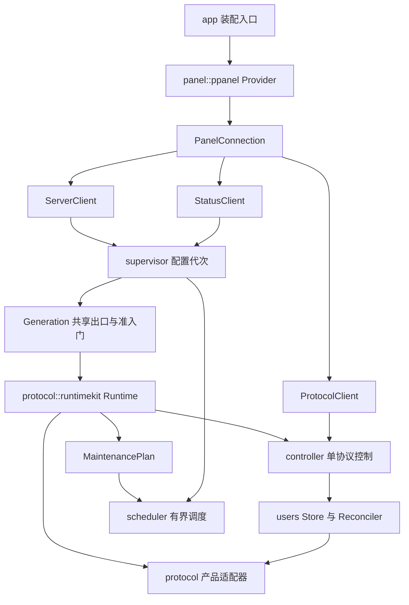

# Terraris 架构设计

状态：架构基线。日期：2026-11-01。B1–B4 基础设施与控制面，以及 B5 VLESS/TCP、UDP/XUDP、GlobalID 迁移、VLESS Encryption、flow 策略和 run CLI 已实现。当前能力见 [README](../README.md) 与 [VLESS 文档](vless.md)；Trojan、AnyTLS、UoT、rustls/aws-lc-rs TLS 入站、本地 PEM 热重载和 WebSocket/gRPC/HTTP Upgrade/XHTTP 传输也已接入；生产运维和剩余协议仍在后续阶段。

Terraris 以 Polaris 的实际模块和生命周期为架构基线：`panel` 隔离面板协议，`supervisor` 管服务器配置代次，`controller` 管单协议用户与维护任务，`protocol::runtimekit` 统一运行时装配，`protocol::flow` 统一数据面策略。通过 Rust 的所有权、类型和异步任务模型实现这些边界。

一个进程连接一个面板、服务一个 `server_id`，运行该服务器配置中的多个入站协议。共享的流处理层承担准入、路由、限速、会话关闭和计量，让每个协议只处理自身的握手与封装。参考基线为 Polaris `56d52fb`，模块来源及有意保留的差异见第 13 节。

## 1 目标与实施范围

首个可用版本以 VLESS 贯通配置拉取、用户更新、TCP/UDP 转发、限速、全局设备名额、在线心跳和流量上报。仅能同步面板的进程属于控制面原型，不宣称是可用代理节点。

生产目标为 Linux x86_64、aarch64；macOS 用于开发。采用 Rust 应用及协议库，不嵌入或启动 Xray、sing-box、Polaris 等 Go 内核。成熟密码库、SQLite 的 C 或汇编依赖可以使用；“Rust 节点”不承诺整个依赖树没有其他语言。

首版集中对接 PPanel，不建立通用多面板插件系统。多服务器部署通过多个服务实例完成，实例之间隔离配置、状态目录和监听端口。不包含客户端、TUN、桌面界面或面板管理 API。

PPanel 下发的数据以 [接口契约](ppanel-api.md) 为准。Polaris 提供架构基线，当前 backend 决定 API 语义；两者不一致的设备租约等能力在面板适配边界补齐。

## 2 整体结构

数据路径为：客户端 → `transport` / `mixed_ingress`（需要时）→ 协议引擎 → 产品适配器 → `protocol::flow` → `route` / `dns` / `outbound` → 目标。`flow` 通过 `session`、`policy` 和 `accounting` 完成会话登记、准入、限速及计量，底层复制和数据报循环由 `dataplane` 提供。

控制面网络请求不进入逐包、逐字节转发路径。首次出现的受限设备需要在建立代理会话前调用面板申请名额；成功后，转发只使用本地状态，由后台任务续期。

TCP 字节流和 UDP 数据报分别建模。QUIC 流可以交付字节流接口；QUIC DATAGRAM、原生 UDP 和协议内 UDP 会话保留数据报边界、目标地址与会话身份。

## 3 工程与模块边界

初期使用一个 Cargo package，包含二进制入口和可测试的内部模块，模块命名与 Polaris 对齐。现成 Rust 协议引擎以依赖引入；需要自研且可独立复用的引擎再单独拆 crate。crate 数量不决定架构分层，跨模块依赖规则从第一版生效。

`route` / `dns` / `outbound` 已实现独立模块并由公共 `egress` 接入 VLESS、Trojan、AnyTLS 的 TCP/UDP/XUDP/UoT：顺序规则、GeoData、分域 DNS、缓存、DoH/DoT，以及直连/阻断/DNS/SOCKS5/HTTP/VLESS 出站。限速按协议/订阅共享。实现语义和当前范围见 [路由与 DNS](routing-dns.md)。

协议、出站和字节流传输已有工厂注册表；Node 使用 `Supervisor<protocol::Registry>`，内置 VLESS/Trojan/AnyTLS、现有出站与 TCP/raw、WS、gRPC、HTTP Upgrade（含入站和出站 TLS）通过注册表装配。新增实现不需要更改 Node、Supervisor 或路由的协议分派；接口与生命周期见 [注册表](registries.md)。

以下是目标模块划分；当前已实现 `app`、`config`、`panel` 及 B1–B4 基础设施和控制面。B5 已引入 VLESS、flow、限速和设备执行器；其余目标模块按后续阶段实施：

| 拟定 Rust 模块 | 职责 | Polaris 对应位置 |
| --- | --- | --- |
| `app` / `config` | CLI、本地配置、依赖装配、信号和退出 | `cmd`、本地配置入口 |
| `resource` / `buffer` | 受管理容量、作用域许可、拥有者、共享视图与受限缓存池 | 参考 sing buffer、XHTTP holder 及数据面资源约束，以 Rust 实现 |
| `task` / `time` | 取消传播、任务回收、单调截止时间与可测试时间 | 参考 context、scheduler 的生命周期约束 |
| `network` / `codec` | 地址与包元数据、流/数据报端口、有界编码辅助 | 参考 sing metadata/network/bufio，不搬入 Go 类型 |
| `panel` | 面板中立的端口、规范化模型、Validator 和策略 | `internal/panel` |
| `panel::ppanel` | PPanel DTO、鉴权、业务响应和显式转换 | `internal/panel/ppanel` |
| `panel::http` | HTTP 连接池、路径前缀、超时、限长与脱敏 | `internal/panel/internal/httpapi` |
| `supervisor` | 全服务器配置代次、工厂、共享出口、整体提交与回收 | `internal/supervisor` |
| `controller` | 单协议用户同步、策略应用、上报任务及生命周期驱动 | `internal/controller` |
| `runtime` | 生命周期端口、快照和 AdmissionGate；不装配具体协议 | `internal/runtime` |
| `users` | 用户模型、Store、Diff、Candidate 与事务化 Reconciler | `internal/users` |
| `protocol::runtimekit` | Core、Runtime、监听器生命周期、PreparedUsers | `internal/protocol/runtimekit` |
| `protocol::<name>` | 配置和凭据转换、协议 server 构造、错误映射 | `internal/protocol/<name>` |
| `protocol::flow` | 统一准入、会话登记、路由、拨号、转发和撤销 | `internal/protocol/flow` |
| `session` / `policy` | 会话及在线租约、设备准入、共享限速桶 | `internal/session`、`internal/policy` |
| `accounting` | Counter、Reporter；扩展持久化待上报队列 | `internal/accounting` |
| `route` / `dns` / `outbound` | 路由编译、解析、出站实例与共享 Egress | 同名 `internal` 包 |
| `transport` / `certificate` | TLS、WS 等载体和证书生命周期 | 同名 `internal` 包 |
| `mixed_ingress` | 后续的同端口分类与分发，能力未实现时拒绝端口冲突 | `internal/mixedingress` |
| `dataplane` | TCP 双向复制、数据报处理、缓冲与背压 | `internal/dataplane` |
| `scheduler` / `telemetry` | 有界维护调度、日志、状态与诊断 | `internal/scheduler`、`logging`、`diagnostics` |

模型随所属领域定义，不建立收集所有类型的全局 `model` 模块。面板 JSON/Protobuf DTO 只出现在 `panel::ppanel`；用户与运行时模型不直接承担第三方面板序列化职责。

依赖规则：

- `app` 装配 PPanel Provider、运行时工厂和服务；首版只注册 PPanel，保留 Provider 边界供隔离与测试。
- `supervisor` 使用 `ServerClient` 和 `runtime::ProtocolRuntime`；`controller` 使用 `ProtocolClient`、`users` 和运行时端口，两者不导入 `panel::ppanel`。
- `protocol::runtimekit` 装配 Controller 与 Core；`protocol::<name>` 仅提供协议配置、server 和用户更新能力。
- `protocol::flow` 不依赖具体协议或面板实现，`dataplane` 不依赖面板 DTO。
- 可复用协议引擎不依赖 Terraris 的面板、订阅、计费或会话类型；稳定的引擎用户标识由产品适配器转换为订阅身份。

### 面板端口

沿用 Polaris 的 `Provider → Connection → Server / Protocol / Status` 分工。HTTP 连接池可以共享，端口身份不可混用。

| 端口 | 拟定职责 |
| --- | --- |
| `ServerClient` | 拉取完整配置，输入已提交 Validator，输出候选模型及新 Validator |
| `ProtocolClient` | 绑定规范协议名；用户、在线、流量、设备计数及原子名额申请 |
| `StatusClient` | 上报主机状态及该协议的已生效证书指纹，由服务器级调度统一驱动 |
| `ProtocolPolicy` | 显式描述设备准入和在线上报语义，不让 Controller 根据面板名称分支 |

为当前 PPanel 将设备策略明确为“面板原子租约”，并在 ProtocolClient 增加申请接口；不能照搬 Polaris 快照中的 `DeviceBaselineNone`。在线上报需要当前活跃集合和未确认短会话集合。能力由类型化配置声明，不靠运行时类型断言或试探请求猜测。

### 共享运行时

`runtimekit::Core` 装配共享 Egress 引用、Counter、Limiter、SessionRegistry 与 AdmissionGate。`runtimekit::Runtime` 组合 Core、Controller 和协议 Server，并提供统一生命周期。单协议适配器不再复制轮询、关闭、排空和报告循环。

Core 还必须接收受预算控制的 buffer 分配接口和任务作用域。协议适配器不能私建无界内存池或无主后台任务；这些基础设施先按 [实施顺序](infrastructure.md)落地，再接 RuntimeKit。测试也要显式提供预算，不能用默认无限资源掩盖生命周期错误。

`runtimekit::Lifecycle` 统一能接管 socket 的协议服务器；QUIC 或外部库自行持有 Endpoint 时，实现相同的生命周期端口，明确其排空能力。不能为统一类型而假定每个库都能交出底层监听器。

Server 的认证读取与 `PreparedUsers` 提交必须通过同一发布机制协调。Rust 中优先替换完整的不可变认证快照；必须调用可变库 API 时，用短提交区保护，禁止握手 I/O 持锁等待。

## 4 身份与状态所有权

| 概念 | 标识与作用域 |
| --- | --- |
| 面板身份 | 规范化面板地址及 API 路径前缀；凭据另行保存 |
| 服务器身份 | 面板身份 + `server_id` |
| 面板协议作用域 | 服务器身份 + 面板规范协议名 |
| 本地入站身份 | 协议作用域 + 本地监听信息；不能替代面板作用域 |
| 订阅身份 | 面板返回的正 `int64` 用户 ID；实际是订阅 ID |
| 用户认证版本 | 协议作用域 + 订阅 ID + 凭据代次 |
| 设备身份 | 面板身份 + 订阅 ID + 规范化来源 IP，跨协议去重 |
| 流量归属 | 服务器身份 + 协议名 + 订阅 ID |
| 速度限制 | 首版按服务器协议作用域 + 订阅 ID，共享所有连接和上下行 |

速度限制沿用现有节点按协议聚合的行为；不承诺跨节点全局限速，也不默认将不同协议的带宽合并。设备限制则必须使用面板的全局原子准入，不能用本地计数近似。

一个 `server_id` 下同协议的多个监听器无法在现有上报接口中分别计费或获得不同用户列表。首版拒绝重复协议配置，避免将多个独立节点错误映射到一个面板作用域。

用户快照包含凭据索引、订阅身份和限制参数，整体发布。数据路径持有只读快照及可撤销的会话许可。索引不以 UUID 代替订阅 ID；删除后重新添加的相同凭据，也不能继承旧订阅的计数和许可。

状态所有权按寿命划分：

| 寿命 | 所有者和资源 | 释放条件 |
| --- | --- | --- |
| 进程 | App 持有 PanelConnection、资源预算、BufferPool、全局设备租约服务、持久化队列和协议作用域索引 | 所有活跃及退役代次关闭后；共享 buffer 的最后拥有者负责释放其分配 |
| 协议作用域 | Supervisor 保留 UserStore、Counter、Limiter、SessionRegistry 的稳定身份；同作用域最多一个维护任务所有者 | 无活跃或退役运行时引用；待上报数据另行保留 |
| 配置代次 | Generation 持有共享 Egress、DNS/路由快照、准入门、运行时集合和维护计划 | 所有该代次会话、运行时结束后，最后释放共享出口 |
| 单协议运行时 | Runtime 持有 Controller、Server、监听器及任务句柄，借用稳定的协议状态和代次资源 | StopAccepting、Drain、Close 完成后 |
| 单连接或会话 | 会话许可持有取消句柄、来源 IP 引用、上下游、BufferScope 和计数句柄 | 结束、撤销或强制关闭；buffer 配额在最后保留视图释放后归还 |

Polaris 已将协议 Counter 保留在 Supervisor 中并跨代次注入。Terraris 将稳定身份延伸到用户、限速和会话注册服务，使旧连接排空期间仍受当前用户撤销和限速约束；这是明确的设计扩展，不声称 Polaris 已采用同样的全部状态布局。

候选准备只能构造私有快照，不得提前修改共享 UserStore、限速桶或设备状态。跨代次提交用统一发布门协调；替换协议对象不销毁待上报流量。Rust 的 `Drop` 负责同步资源释放和取消兜底，等待任务、刷新队列仍通过显式异步 `close` 完成。

GlobalID UDP socket 由进程级会话表管理，承载连接只持有可失效的接管许可。新连接重做用户/设备准入后才能迁移；旧连接退出不取消新连接的许可。用户认证版本和出站策略参与迁移键，断开缓存受时间、会话数量和 buffer 预算限制。

关闭旧 Runtime 只取消自己的任务、关闭自己的会话并释放借用句柄，不清空新代次仍在使用的 UserStore、Limiter 或 Registry，也不启动第二个 Reporter。维护任务交接使用作用域所有者标识，已失去所有权的旧任务不能提交迟到结果。

新旧代次共享进程级资源上限，重载不能给候选重新发放一份完整内存预算。旧连接或排队视图继续保留的分配仍计量，直到真正释放；BufferPool 不随单个协议运行时销毁。

热路径优先使用不可变共享数据、分片计数器和短临界区。异步 I/O 通过有界队列交给状态所有者；不跨 `.await` 持有用户、会话或流量映射的锁。这与 [Tokio 的共享状态指导](https://tokio.rs/tokio/tutorial/shared-state)一致。

## 5 配置与用户更新

### 配置发布

采用 Polaris 的候选代次和分阶段提交。Supervisor 不把“端口已绑定”当成“允许代理流量”，候选代次的 AdmissionGate 从创建起保持关闭。

1. `Fetch / Normalize`：拉取配置并生成候选 Validator；校验协议、重复定义、端口、DNS、路由和证书。
2. `PrepareControl`：创建共享 Egress、各协议 Core 和 Server，获取并准备用户；不开放接入，不启动维护任务。
3. `PrepareListener`：全部协议控制状态准备好后，再准备所需监听器；失败时释放候选资源。
4. `PublishUsers`：在提交点检查配置及用户源版本，发布候选私有认证表；尚不覆盖活跃共享用户状态。
5. `CommitAdmission`：逐个完成监听器交接，代次准入门仍关闭；任何一步失败，都回收候选，保留旧代次。
6. `PublishGeneration`：在短提交区内发布准备好的共享用户/策略状态、ActiveGeneration 和 Validator；注册已生效证书指纹并打开代次准入门，交接维护任务所有权。
7. `RetirePrevious`：先停止旧监听器接受连接，再限时排空，最后关闭运行时和共享出口。

所有可能失败的认证库发布应在第 4 步对候选私有状态完成；最终共享状态切换只能包含已准备好的本地操作，不包含 HTTP、磁盘写入或不受控的库调用。不能把跨多个协议依次修改在线用户表称为原子提交。共享状态与认证索引的观察要通过发布门或一致版本句柄协调。

配置 Validator 包含 ETag 和响应体指纹，并与表示及作用域绑定。内容相同但验证器变化时只推进验证器，不重建协议。HTTP 客户端返回候选值，提交权属于 Supervisor；准备失败保留已提交状态。缺少 ETag 的处理以接口契约为准。

用户轮询与配置准备可以并行执行，但提交使用本地单调递增 revision 检查，不能只依赖可能重复或缺失的 ETag。候选准备期间用户已更新时，重新生成其认证状态。配置失败不阻塞活跃 Controller 的用户撤销。

失败清理、旧代次排空和末次上报放在提交锁外；健康检查不能被一次慢面板请求卡住。取消一个准备操作也不能顺带取消已经提交、仍在服务的运行时任务。

### 监听器切换

| 变化 | 处理方式 |
| --- | --- |
| 用户、限制、路由更新 | 发布快照；通常无需重绑 socket |
| 证书更新 | 校验证书与私钥后替换新握手的证书解析器；已有连接按原会话结束 |
| 新端口 | 提前绑定，成功后发布并停止旧端口接入 |
| 同端口 TCP 协议运行时替换 | 参考 Polaris 的代次共存和停止旧接受流程；绑定策略由 Lifecycle 或共享 ingress 提供 |
| 无法复用的 socket 或 QUIC Endpoint 参数变更 | 默认拒绝此次热更新并保留旧服务；显式允许中断更新时执行重绑与失败恢复 |
| 协议移除或用户撤销 | 停止接入，并关闭对应旧会话；不等待普通排空期限 |

Polaris 使用 `SO_REUSEPORT` 让新旧监听器短暂共存。Terraris 的 Linux TCP 后端可以采用该策略，但要验证双方 socket 选项、绑定与提交失败、准入门打开和停止旧接受之间的竞态。平台或协议不支持时，不伪装成无损热更新。共享 ingress 是另一种可选绑定后端，不让每个协议重复实现 socket 分发。

QUIC Endpoint 持有连接状态，不能直接把 TCP 的 reuseport 策略用于独立 QUIC 实例。保留 Endpoint 的证书或认证更新与重新创建 Endpoint 分开声明能力。允许中断的更新须保留旧配置和恢复材料；恢复失败进入不可就绪状态，不能报告回滚成功。

`StopAccepting` 仅停止新接入，`Drain` 等待已经接入的会话，`Close` 取消剩余会话并回收资源，三者不能合并成一个含义不明的 stop。旧的多路复用连接在排空时，已有子流可以结束，新子流作为新会话拒绝；底层库必须能区分这两种情况。

未知协议可跳过并展示为不支持；本地明确要求的协议不支持时不能就绪。至少一个协议实际运行，且所有本地要求的协议可用，才能报告数据面就绪。已支持协议上的未实现安全、传输或策略选项必须拒绝候选，不能忽略后继续运行。面板返回空协议列表则关闭全部入站，保留同步任务等待后续配置。

### 用户发布

用户更新使用与 Polaris `users::Reconciler` 对应的 Store、Candidate、Diff 和 Prepared 操作：

1. 获取当前快照及 revision，以此创建完整 Candidate，检查 ID、凭据冲突、长度和限制。
2. 计算 Diff；预先构造新认证状态、限制变化及待关闭会话集合。这一步可失败或取消，不修改在线状态。
3. 取得串行发布许可，再次比较源 revision；过期候选 Abort 并重新同步。
4. 在认证与用户发布门内提交认证状态、用户和策略快照，标记撤销并安排会话关闭，最后推进 Validator。提交失败不能推进 Store 或 ETag。
5. 耗时的连接回收和上报在门外执行；一旦提交成功，迟到的取消不能被当作“从未提交”而重放。

准备句柄只有待提交、已提交、已中止三种状态；一次性用户发布只能消费一次，Abort 不能回滚已经对外可见的结果。若协议库的提交可能部分生效后报错，必须通过影子实例、可替换快照等方式适配，不符合约束的库不能直接接入热更新。

`304` 保留当前用户；成功的空数组撤销全部用户；请求或解码失败保留旧快照并记录其年龄。不能将部分合法记录当成完整用户列表。设备计数失败独立退避，不能阻止已经收到的有效用户撤销。

移除用户或修改凭据时，先关闭准入，再取消该认证版本的会话，包括等待设备申请、DNS、拨号的任务。拨号后、向客户端确认成功前再次检查许可。TCP、UDP、QUIC 多路复用子流都需要覆盖此过程。

仅修改限速时更新共享桶；设备限制从无限改为有限时，现有来源 IP 也需要取得租约。限制降低时已有有效租约按 backend 规则续期，新 IP 由 backend 决定是否允许。

### 维护任务调度

沿用 Polaris 的 `MaintenancePlan`：Controller 描述 users、traffic、online 等任务及周期、超时和退避；Supervisor 汇总服务器状态与证书任务，由有界 Scheduler 驱动。协议 Server 不私自启动面板轮询循环。

每个作用域的同类任务最多一个在途请求。用户同步、流量报告和在线续期独立退避，在线续期保留并发预算，不能被流量重试长期占满。主机状态采样由服务器级任务统一完成，再经绑定协议的 StatusClient 上报所需指纹。

退役代次不保留第二套用户轮询和重复 Reporter。活跃 Controller 持有该协议作用域的维护权，覆盖稳定注册表中的旧会话；已移除协议的最终流量交给进程级待上报队列处理。所有任务有可追踪的取消与等待句柄。

## 6 统一连接处理

连接路径为：传输握手 → 协议认证 → 登记可取消会话 → 设备准入 → 路由与 DNS → 拨号 → 转发 → 释放会话。

参考 Polaris 的引擎与产品适配分离：协议引擎交付稳定用户标识、目标及载体，`protocol::<name>` 将标识映射为已认证订阅和认证版本，再向共享 `protocol::flow::Handler` 交付来源地址、目标地址及字节流或数据报接口。只有认证完成后才能创建用户流量记录；协议握手开销另做运维指标。

协议引擎不自行直连目标、不另起计费系统；准入或拨号失败由产品适配器映射回该协议的握手结果。`flow` 把会话登记在任何可阻塞的设备申请、DNS 或拨号之前，避免撤销留下未追踪的建立中连接。

`flow` 选择策略并管理生命周期，`dataplane` 负责实际复制、半关闭、短写、背压与数据报边界。计量定义为实际成功转发的应用负载字节：客户端到目标为 upload，反向为 download；UDP 只在有效会话中统计成功转交的数据报负载，不将重传或协议头重复计入。

限速采用协议作用域内共享的用户令牌桶，避免每开一个连接就获得一份完整带宽。TCP 等待额度并响应取消；UDP 使用有界排队或丢包，不无限缓冲。单位换算为 `Mbps × 1,000,000 / 8` 字节每秒，0 表示不限速。

DNS 和出站使用结构化能力声明。像 Polaris 的共享 Egress 一样，每个配置代次只创建一份可共享的 Router、Resolver 与 OutboundSet，各协议持有引用；协议自身的上游会话池在对应出站内维护。共享引擎已经编译规则和 DNS 配置；相同策略的配置代次复用缓存及出站，未知选项仍拒绝候选，代理失败不回退直连。目标策略在域名及实际拨号 IP 两处校验，避免解析结果绕过限制。

`transport` 处理协议载体，`certificate` 管证书，`mixed_ingress` 处理有明确分类依据的同端口分发。这些能力不归某个 Shadowsocks 或 VLESS 模块所有；首版未实现端口复用时显式拒绝冲突，不用模糊嗅探猜测。

来源 IP 默认取 socket 对端。PROXY protocol 只在显式启用且对端属于本地可信代理范围时接受；拒绝将任意客户端提供的地址用作设备身份。

## 7 设备租约与在线心跳

`/alivelist` 用于观测，`/device` 是有限额订阅获得新 IP 名额的准入依据。先认证，再对相同设备键的并发申请合并为一个请求。用户版本变化后，迟到的准入响应不能重新激活旧会话。

将 IPv4-mapped IPv6 规范化为 IPv4。以 backend 返回的 TTL 和本地单调时钟管理租约；设置提前续期间隔，不将本机墙上时钟当成 Redis 的时间。

在线心跳独立于流量上报，建议不超过 60 秒，并留足 TTL 余量。快照包含当前活跃 IP 和尚未成功上报的短会话 IP；每批最多 10000 项。短会话上报成功后不继续续期，活跃但没有业务流量的会话仍需续期。

有限额的新 IP 在接口失败时拒绝。已确认租约有效期内允许继续使用；若超过确认有效期仍不能续期，Terraris 的建议策略是停止相应受限会话并拒绝重入，防止长期离线绕过设备限制。无限额用户不因设备接口故障阻断，但仍受用户快照有效期约束。

本地没有“立即释放全局名额”的接口：关闭会话仅减少本地引用，停止后续续期；其他节点可能仍在使用相同 IP，全局记录按面板 TTL 到期。

## 8 流量上报与持久化

数据面只累积原始字节；协议 `ratio` 和时间倍率由 backend 应用。上报阈值用于攒批，未达阈值的字节保留，并在用户撤销、协议移除及退出时尝试刷出。

建议生产版本配置本地 SQLite 待上报队列，通过 [rusqlite](https://docs.rs/rusqlite/latest/rusqlite/) 在专用阻塞工作线程中访问。数据库仅用于控制和上报，不进入逐包路径。状态目录在本机磁盘上；若使用 WAL，遵守其[同主机与 checkpoint 约束](https://www.sqlite.org/wal.html)。

每个不可变批次保存面板目标、服务器、协议、订阅及 upload/download、生成时间和本地批次 ID。凭据独立引用，不将 secret_key 写入批次内容或日志。进程重启前后的待上报批次不能被发送到后来修改的面板或服务器。

处理顺序：计数器交换到内存待提交批次 → 本地事务提交 → HTTP 发送 → 校验 HTTP 和业务成功 → 本地确认。落盘失败时保留内存批次；本地确认写入失败时，本进程记住远端已确认结果并只重试本地确认。重启后仍无法消除不确定性。

建议每秒收集并持久化一次，报告周期遵循面板；阈值以下的数据也进入持久化累计。这里只保证已提交事务的恢复，崩溃可能丢失最后一次成功落盘之后的字节。实际窗口受写盘延迟影响，不能把 1 秒定时器当成严格的数据丢失上界。

队列有磁盘和内存预算。接近预算时告警并限制新会话；无法继续保存计量时限时停止转发，避免无限消耗资源或继续产生无法记录的用量。单个订阅每次请求的上下行合计不得超过 backend 当前的 10 TiB 上限，积压必须拆批。

现有 API 的三个限制需要保留在产品说明中：

1. 没有服务端批次幂等标识。采用失败重试时，响应丢失可能重复计费；本地批次 ID 无法让面板去重。
2. 成功响应不提供逐项确认；面板可能丢弃已不属于该 server/protocol 的订阅或无效记录。因此 ACK 不等于每一项均已入账。
3. 延迟上报按面板接收时的协议倍率及时间倍率处理，节点侧持久化不能保证还原历史费率。

首版沿用现有接口并明确这些边界。后续若要求可核对、无重复的结算，需要单独升级 backend：持久去重键、原子记账与确认、逐项处理结果，以及历史授权和费率规则；本次设计不修改面板。

## 9 协议与依赖规划

### 基础依赖候选

具体版本在原型通过后锁定，并为 Linux 两种架构验证构建；本设计不将网页上的最新版写成兼容性承诺。

| 能力 | 候选 | 验证重点 |
| --- | --- | --- |
| 异步网络和任务管理 | Tokio | 有界并发、取消与所有后台任务的回收；参考[退出流程](https://tokio.rs/tokio/topics/shutdown) |
| 面板 HTTP | [reqwest](https://docs.rs/reqwest/latest/reqwest/) | 连接池、超时、响应大小限制、禁止自动跨源重定向、日志去除 URL query |
| HTTP Protobuf | [prost](https://docs.rs/prost/latest/prost/) | 使用 backend schema 生成 DTO；不是 gRPC，不需要 tonic |
| TLS | [rustls](https://docs.rs/rustls/latest/rustls/) | 证书热替换、密码 provider、目标平台；常规 TLS 不代表支持 REALITY |
| DNS | `hickory-proto` + Tokio/rustls/reqwest | DNS wire 编解码；Terraris 持有分域规则、缓存、并发、IPv4/IPv6 策略和超时 |
| QUIC | [Quinn](https://docs.rs/quinn/latest/quinn/) | 流、DATAGRAM、资源限额；需额外实现 TUIC/Hysteria2 的协议层 |
| Shadowsocks | 原生 RustCrypto/BLAKE3 记录与数据报实现 | AEAD/2022、EIH 多用户、热更新、TCP/UDP、UoT、路由出站及计量；见 [协议文档](shadowsocks.md) |

### 协议推进顺序

| 阶段 | 拟定能力 | 发布门槛 |
| --- | --- | --- |
| 首个协议原型 | VLESS TCP、UDP/XUDP、VLESS Encryption | B5 已完成本地 Xray 互通、用户热更新、撤销与计量验证；能力边界见 VLESS 文档 |
| 已完成协议扩展 | Trojan TCP/UDP、AnyTLS v1/v2、UoT、TLS 入站与本地 PEM 热重载 | 复用同一准入和流处理层；已验证 Xray Trojan 与官方 AnyTLS 客户端互通 |
| 已完成传输扩展 | WebSocket、gRPC、HTTP Upgrade、XHTTP 的入站和出站 | gRPC 池、WS 早期数据、XHTTP HTTP/1.1/2/3 + XMUX；Xray/Polaris 双向互通、代次排空和资源回收已通过本地验证 |
| 第二轮扩展 | TUIC v5、Hysteria2 | 各自独立互通矩阵；QUIC 需验证拥塞控制、UDP 和认证时序 |
| 单独立项 | REALITY、Vision、VMess 及其他协议 | 明确协议版本、实现来源、客户端互通与维护成本后排期 |

Shadowsocks AEAD/2022 已接入独立的认证、重放及 UDP 关联管理，复用既有用户发布事务和 flow 策略；AES-2022 支持 EIH 多用户，非 EIH 模式有明确的试钥数量限制。标准 Go peer 验证双向 TCP/UDP，代码不嵌入 Go。

同样，“使用 Quinn”只提供 QUIC 传输能力，不自动获得 TUIC/Hysteria2 认证、HTTP/3、混淆、拥塞行为或线协议兼容性。每种协议用明确的功能组合声明能力，例如密码套件、TCP/UDP、传输、安全层、插件、mux 和 UoT，而非一个笼统的“支持”开关。

当前 TLS 支持 `file` 和操作者提供本地 PEM 的 `self` 证书，均不自动生成；`http`/`dns` 自动签发单独实现并声明能力。不能将面板要求的 ACME 模式默默改成自签。

## 10 配置与运行方式

本地配置拟用 TOML，保存面板地址、服务器 ID、密钥引用、状态目录、监听地址、可信代理范围、资源限额和诊断设置。协议端口、用户、限速及路由由面板提供；本地约束可以进一步收紧资源，不能放宽面板的用户限制。

密钥通过权限受控的文件或环境变量注入，避免命令行参数泄漏。HTTP 客户端在错误中只输出端点路径、状态和请求标识；不打印完整带 query 的 URL、UUID、证书私钥或面板响应体。显式配置面板 API 前缀，路径拼接不能丢失前缀。

check、capabilities、version 和多协议 run 已实现：

| 命令 | 行为 |
| --- | --- |
| `terraris run --config …` | 已实现：同步配置/用户并运行 VLESS、Trojan、AnyTLS；不支持的协议组合会拒绝 |
| `terraris check --config …` | 本地配置检查，无网络请求 |
| `terraris check --config … --panel` | 只读拉取并校验面板配置及用户；不申请设备、不上报、不监听 |
| `terraris capabilities` | 显示本构建支持的协议与功能组合 |
| `terraris version` | 显示版本和构建信息 |

首版部署形态为 systemd 服务与容器镜像；两个实例不能共享同一状态目录。启动时取得该目录的独占锁。配置默认位于 `/etc/terraris/`，状态位于 `/var/lib/terraris/`，具体路径可以覆盖。

证书与私钥先验证再发布；自签证书由操作者生成并持久保存。文件变化在下次配置同步时触发热重载，失败保留旧身份；见 [TLS 协议文档](tls-protocols.md)。按协议作用域在状态请求中发送 `X-Node-Certificate-SHA256`，防止不同入站的指纹互相覆盖。

收到 SIGTERM 后停止接受新会话、取消轮询，限时排空连接，收集末次计数，提交本地队列并在剩余时间内尝试上报，然后回收所有任务。面板不可达不能无限拖延退出，持久化批次留待下次处理。

## 11 故障与可观测性

| 场景 | 建议行为 |
| --- | --- |
| 首次启动无法取得有效配置或用户 | 不开放代理端口，带抖动退避重试 |
| 面板暂时不可达 | 使用已提交快照，显示同步过期；设备准入仍遵守租约边界 |
| 用户快照长期过期 | 建议可配置 15 分钟上限；超过后拒绝新会话并关闭相关旧会话 |
| HTTP 401/403 | 标记鉴权失效，暂停新准入并关闭旧会话；低频探测恢复 |
| 新配置不合法 | 保留旧配置，报告更新失败；用户撤销继续同步 |
| 上报失败 | 批次保留并退避重试；在线续期有独立调度和并发预算 |
| 监听或关键后台任务异常退出 | 停止该能力的准入，报告不就绪，由 supervisor 决定恢复或退出 |
| 有效空配置 | 无代理监听，继续同步；显示“无启用协议” |

15 分钟、续期间隔和排空时间均是待原型验证的本地默认值，不是 PPanel API 保证。成功的 `304` 也更新快照的最近确认时间。

诊断区分进程存活、数据面就绪、面板同步新鲜度、上报积压与协议能力。面板短暂故障不直接触发存活检查失败，避免重启放大故障。指标包括连接数、认证/准入失败、快照年龄、更新失败、设备续期失败、待上报字节及最老批次年龄。

默认不将订阅 ID、UUID 或 IP 放入指标标签，避免高基数和凭据暴露。诊断接口默认绑定本地回环地址；面板现有状态接口只承载 CPU、内存、磁盘和时间，不能冒充完整健康检查接口。

## 12 实施阶段与验收

| 阶段 | 产物 | 必须通过的验证 |
| --- | --- | --- |
| M0 架构设计 | Polaris 架构映射与 PPanel 接口契约 | 已完成模块、端口和状态所有权设计 |
| M1a 基础工程与面板接口 | Rust 工程、PanelConnection、完整 PPanel 客户端、只读检查 CLI | 已通过本地 JSON/Protobuf 契约测试及 Go 编码样本互操作；真实部署联调待完成 |
| M1b 基础设施与 Buffer | resource、buffer、task/time、network/codec、基础 dataplane 与指标 | B1–B3 已完成，已验证预算、回收、双向复制、数据报和 codec；性能及生产部署仍待验证 |
| M1c 控制面与协议可行性 | scheduler、users、Supervisor/Controller、RuntimeKit、模拟运行时和 VLESS 适配 | B4 模拟验证及 B5 VLESS 实际驱动、共享监听器和热更新已完成本地验证 |
| M2 首个代理闭环 | VLESS TCP/UDP/XUDP、Encryption、用户快照、flow、限速与设备准入 | Xray 本地互通和策略测试已通过；真实面板及跨节点设备竞争仍需验证 |
| M3 生产运行基础 | 持久化上报、更新恢复、退出与服务包装 | 响应丢失、重启恢复、存储失败、证书替换、长期离线、负载与资源限额测试 |
| M4 协议扩展 | 按能力矩阵逐项增加协议 | 每个协议沿用 M2/M3 的策略与故障测试，增加独立互通用例 |

当前测试覆盖面板接口、HTTP/CLI，B1–B3 基础设施，以及 B4 的候选回滚、版本竞争、代次切换、调度、报告和关闭。以下是全阶段验收要求；B4 的模拟验证仍需在真实协议与部署上补充：

- buffer 和队列预算不超限，共享视图不提前回池，取消/关闭并发恰好回收一次；重载不重置总预算。
- 同一订阅多连接和双向流量共享速率；增加连接不会突破总限制。
- 相同 IP 跨节点和协议去重；两个新 IP 同时争夺最后一个名额只有一个成功。
- 用户在握手、设备申请、DNS、拨号、转发各阶段被撤销后无法继续使用。
- 无流量长连接持续续期，短连接至少上报一次，关闭的 IP 不持续占用租约。
- 更新失败不会替换当前服务；迟到的旧响应不能覆盖新用户状态；协议移除后积压仍存在。
- 候选某协议在 PublishUsers 或 CommitAdmission 失败时，其他候选协议仍无法代理流量；已生效指纹不被失败候选替换。
- StopAccepting 后不产生新连接或新复用子流，已有会话在排空期限内完成；旧会话仍接受新用户撤销和限制。
- 多协议只共享一次代次级出口资源，每个协议作用域只有一个维护所有者；慢流量报告不阻塞设备续期。
- 上报阈值、失败重试和退出不丢弃累计字节；故意丢失 ACK 的测试展示现有协议的重复风险。
- 面板订阅生成的客户端配置直接互通，TCP 与 UDP 分别确认计量方向和认证身份。

性能验证先测吞吐、CPU、内存、握手延迟、用户更新停顿和积压恢复，覆盖大量用户、短连接、长连接及 UDP。对比旧节点时固定硬件、加密、缓冲区、并发和链路；不预先承诺 Rust 一定更快。

## 13 Polaris 映射与差异

下表的 Polaris 行为来自本地代码和架构文档，Terraris 一列是拟定实现，不代表已完成移植。

| 主题 | Polaris 基线 | Terraris 决定 |
| --- | --- | --- |
| 面板边界 | Provider、Connection、Server/Protocol/Status 端口；当前只注册 PPanel | 采用该隔离方式，首版仍只实现 PPanel |
| 生命周期 | Supervisor / Controller、Core / Runtime、PreparedListener / PreparedUsers | 沿用职责和阶段，用 Rust 所有权及显式异步关闭实现 |
| 协议与业务 | 可复用引擎和产品适配器分开；共享 flow 和 dataplane | 沿用，协议库不能绕过统一策略 |
| 全局设备准入 | 当前 PPanel adapter 未接入新原子名额接口 | 扩展 ProtocolClient 和显式策略，使用 backend 当前租约接口 |
| 跨代次状态 | Supervisor 保留协议 Counter；Egress 按代次共享 | 采用，并让限速、用户及会话服务保持协议作用域的稳定身份 |
| 流量重试 | Reporter 在内存中 detach、失败 merge，存在崩溃丢失与重试重复 | 保留计数和报告分离，生产阶段增加本地持久化，幂等限制仍明确 |
| TCP / QUIC 更新 | 生命周期支持停止接入和排空；具体协议持有监听器 | 采用这些端口；TCP reuseport 需验证，QUIC 按 Endpoint 能力决定是否可热更新 |
| 排空中的复用连接 | 旧代次准入门保持开启，已有连接仍可开子流 | 旧代次停止新子流，只排空已登记会话；作为明确的策略差异验证 |
| PROXY protocol | 自动识别且接受任意来源的合法 header | 首版保留显式启用与可信代理范围，防止伪造来源影响全局设备租约 |
| 进程退出 | 退出不排空，终止正在退役的代次 | 保留可配置的限时排空和落盘；不能把热更新排空当作退出的无期限等待 |
| 缺少新 ETag | 原实现保留旧 ETag | Terraris 在 200 未携带 ETag 时清除旧值，仍用内容指纹与本地 revision 防止错误推进 |
| 协议覆盖 | 多种现有 Go 协议实现与适配器 | 借鉴扩展边界；Rust 协议支持按独立互通矩阵推进，不承诺功能已等价 |

架构对照的主要代码位置：

- [面板端口](../../../Polaris/internal/panel/provider.go)、[PPanel 注册](../../../Polaris/internal/panel/builtin/registry.go)。
- [代次准备](../../../Polaris/internal/supervisor/bootstrap.go)、[提交与回收](../../../Polaris/internal/supervisor/publish.go)、[维护任务汇总](../../../Polaris/internal/supervisor/maintenance.go)。
- [Controller 准备](../../../Polaris/internal/controller/controller_prepare.go)、[Controller 生命周期](../../../Polaris/internal/controller/controller_lifecycle.go)、[维护计划](../../../Polaris/internal/controller/maintenance.go)。
- [用户事务协调](../../../Polaris/internal/users/reconcile.go)、[运行时端口](../../../Polaris/internal/runtime/ports.go)。
- [RuntimeKit Core](../../../Polaris/internal/protocol/runtimekit/core.go)、[Runtime](../../../Polaris/internal/protocol/runtimekit/runtime.go)、[监听器生命周期](../../../Polaris/internal/protocol/runtimekit/listener.go)、[PreparedUsers](../../../Polaris/internal/protocol/runtimekit/users.go)。
- [共享 Flow Handler](../../../Polaris/internal/protocol/flow/handler.go)、[TCP 流处理](../../../Polaris/internal/protocol/flow/tcp.go)、[Reporter](../../../Polaris/internal/accounting/reporter.go)、[同端口入口装配](../../../Polaris/internal/supervisor/mixed_ingress.go)。

## 14 当前依据

本地核对基线：backend `764e937c`、ppanel-node `57dddf2`、Polaris `56d52fb`。这些是本次设计的仓库快照，不代表线上部署版本。

- [backend 节点路由](../../backend/internal/transport/http/routes/server.go)与 [server.proto](../../backend/api/server/v1/server.proto)。
- [backend 设备租约](../../backend/internal/module/network/internal/serverapi/devices.go)与[流量聚合](../../backend/internal/module/network/internal/trafficagg/aggregator.go)。
- [ppanel-node 用户及流量接口](../../ppanel-node/api/panel/user.go)、[流量队列](../../ppanel-node/node/traffic.go)和 [SS 用户转换](../../ppanel-node/core/user.go)。
- [Polaris 架构](../../../Polaris/docs/architecture.md)及其 [PPanel 适配器](../../../Polaris/internal/panel/ppanel/client.go)。该快照的设备基线方法仍为空实现，Terraris 必须接入 backend 当前的 `/device` 与 `/alivelist`。
