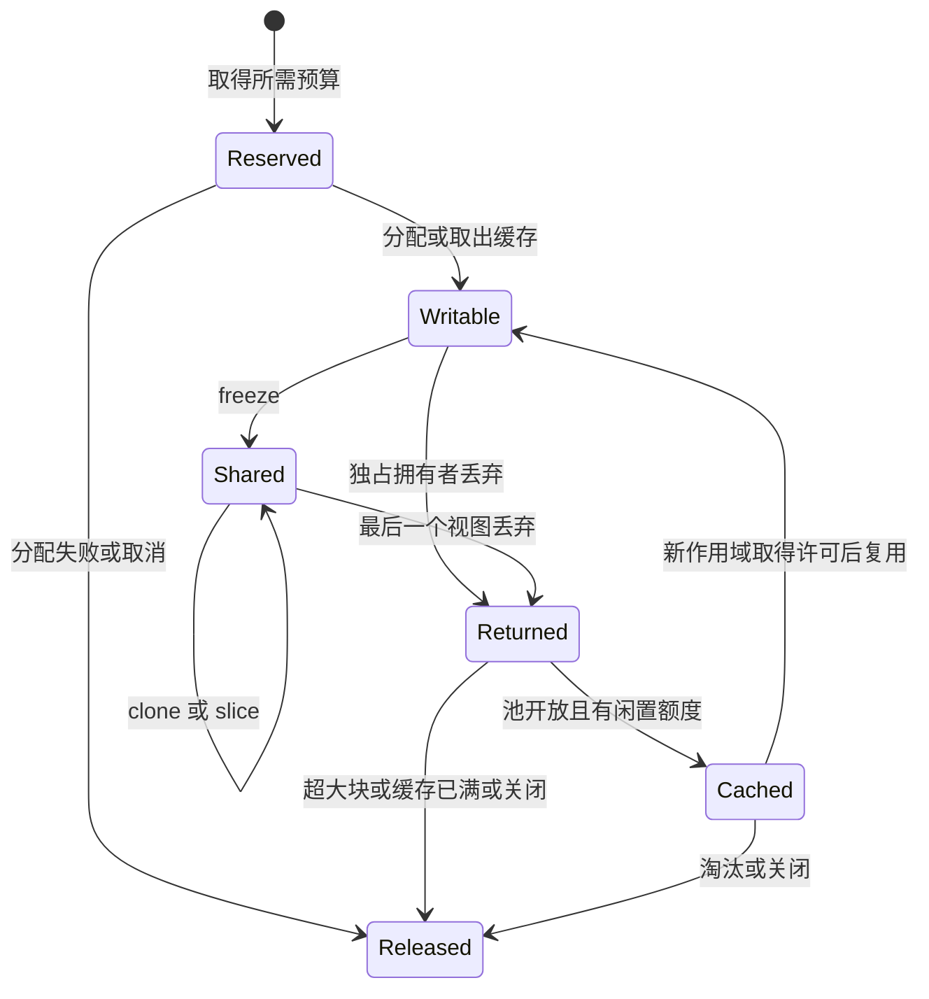

# Terraris Buffer 系统设计

状态：B1 已实现，后续能力仍为设计。日期：2026-11-01。当前提供预算许可、BufferLayout、BufferScope、独占 BufferLease、固定容量操作和批量预留/失败回滚。共享视图、缓存池、队列和异步额度等待尚未实现。

核心决定：缓冲拥有者持有资源许可，池只负责复用已分配存储，队列单独控制消息数和字节数。通过独占可写对象与不可变共享视图区分修改和传递，最后一个拥有者释放后才允许回收。

## 1 范围

覆盖 TCP 转发、UDP 包、协议帧、加密封装的 header/tag 空间以及协议需要的有界队列。Buffer 不携带订阅、倍率或路由；网络元数据放在独立的数据报/帧对象中。

第一版保持 `unsafe_code = "forbid"`。使用已初始化的存储和受检范围，不提前引入未初始化切片、自定义分配器或无锁回收。

“零拷贝”只描述某次冻结、切片或所有权传递没有复制 payload，不表示 TLS/QUIC、系统调用和网卡链路都没有复制。

## 2 类型与职责

以下覆盖目标系统的接口职责。当前公开 API 是 BufferLayout、BufferLease 和 BufferScope；Allocation 为内部类型，其余共享/缓存/队列类型待 B2 引入。

| 类型 | 所有权和职责 | 约束 |
| --- | --- | --- |
| `BufferLayout` | 申请的前置空间、payload 容量、后置空间 | checked arithmetic；先验证总大小与单块上限 |
| `Allocation` | backing storage 及其进程容量许可 | 分配存在期间许可一直存在，进入缓存也不释放 |
| `BufferLease` | 独占 Allocation、当前作用域许可和有效范围 | 不实现 Clone，通过可变借用修改 |
| `SharedBuffer` | 冻结后的拥有者和只读范围 | 切片/Clone 共享分配，不能原地修改 |
| `BufferPool` | 按尺寸类别缓存 Allocation，管理闲置容量 | 不是无界全局缓存，不持有用户对象 |
| `BufferScope` | 连接/子流的预算身份 | 最后保留视图消失前，用量不能归零 |
| `Packet` | 网络元数据及一个 buffer | 明确包边界，与存储生命周期分开 |
| `BufferQueue` | 有界消息数、逻辑字节数和队列许可 | 入队项继续持有分配与作用域许可 |

Allocation 当前采用固定长度、已初始化的 `Box<[u8]>`，由安全的 fallible Vec 预留及初始化构造。独占状态不为每块 payload 再包一层 Arc；B2 第一次冻结时再创建共享拥有者，视图记录范围。

B1 的资源 API 为 Budget、Scope、Limits、Reservation、Permit 和 Snapshot。进程及全部祖先额度在同一把短锁下检查；原子字段只用于安全共享存储，不意味着无锁算法。Scope 的深度有 32 层上限，Limits 同时控制字节数和分配名额，零容量 lease 也占一个名额。

外部库使用的 Bytes / BytesMut 留在适配边界。不能将一个可任意扩容、拆分和取出底层存储的 BytesMut 直接暴露为“已受预算控制的 buffer”。

## 3 布局与读写

```text
allocation capacity
┌──────────────────┬────────────────────────┬──────────────────┐
│ reserved prefix  │ payload + unused room  │ reserved suffix  │
└──────────────────┴────────────────────────┴──────────────────┘
                   start              end
```

不变量是 `0 <= start <= end <= capacity`。前后预留空间参与申请大小和预算；有效载荷不足一个尺寸类别时，余下容量也不能漏计。

| 操作 | 行为 |
| --- | --- |
| 读取有效数据 | 只暴露已提交范围，不暴露池中残留字节 |
| I/O 写入尾部 | 由受控适配器接入 ReadBuf，使用实际 filled 长度推进范围 |
| 添加 payload | 保留 suffix，不允许普通 append 抢占 tag 空间 |
| prepend header | 检查前置空间，先写入新字节再扩大可读范围 |
| append trailer | 显式消耗后置空间，封包过程结束 payload 写入阶段 |
| consume / truncate | 只调整有效范围，不释放 backing allocation 的预算 |
| freeze | 消费 BufferLease，转为 SharedBuffer；payload 不复制 |
| grow / detach | 显式申请新存储并复制；旧、新分配重叠期间都计量 |

不开放任意 `set_len`、`DerefMut<Vec<u8>>`、隐式 reserve 或脱离许可的 `into_vec`。布局不足返回结构化错误，不 panic，也不悄悄扩容。B1 的 read_from 使用 ReadBuf，仅在一次 poll 成功后提交 filled 字节；满 buffer 返回错误，不返回容易误解为 EOF 的零长度。

B1 在 append_trailer（包括零长度）后封口 payload，仍允许追加剩余 trailer 和外层 header。实际 consume/truncate 后进入只读消耗状态，clear 恢复初始布局。freeze、grow 和 detach 尚未开放。

新分配初始化一次，缓存复用时清空逻辑范围。新暴露的 header、tag、padding 区域必须先初始化，I/O 路径只能提交其实际写入长度；codec 不能把 capacity 当数据长度。用跨连接哨兵数据验证旧 payload 不会被读出或发送。密钥和长期凭据使用单独的保密存储，不进入通用包池。

前后空间由目标封装链汇总。不能假定所有协议只在尾部加 tag；Polaris 的 [headroom 修复](../../../Polaris/internal/dataplane/coalesce.go)说明普通写入与合并写入都需要遵守同一布局约定。

## 4 冻结与共享生命周期



共享视图必须持有 owning handle，不能只携带裸范围。一个 1 字节切片保留着 64 KiB 原始分配时，仍计量 64 KiB；原始对象先 Drop 不能提前归还预算或把内存交给另一个连接。

通过 [Bytes::from_owner](https://docs.rs/bytes/latest/bytes/struct.Bytes.html#method.from_owner) 交给外部库时，将存储、回收状态和许可一起交给 owner。所有 Bytes Clone/切片释放后才结束 owner 生命周期。该构造方式转回 BytesMut 会复制，try_into_mut 也不能恢复原可写存储，因此不把它设计成无成本双向转换。

需要修改共享数据时，第一版显式申请新块并复制。以后可以增加内部唯一引用恢复操作，但不把一次引用计数检查当成跨线程永久保证，也不让外部 Bytes 适配绕过拥有者。

大块上的小视图需要长期排队时，可显式复制到较小块减少保留容量。复制需要新预算；申请失败保留原视图并返回失败，不能先释放原块再复制。

## 5 三类预算

### 分配容量

```text
resident_capacity = active_allocation_capacity + idle_cached_capacity
budget_used = resident_capacity + reserved_not_yet_allocated
budget_used <= configured_buffer_budget
```

这里计量 buffer 层管理的分配容量，不是进程 RSS。分配器额外开销、对象元数据、栈、内核 socket、TLS/QUIC 内部缓冲及外部库自行分配的内存另有上限或观测，不能宣称一个 buffer budget 控制整个进程。

进程容量许可跟随 Allocation 从创建到真正释放。B1 的 reserved/resident 分别表示未完成存储分配的预留与已提交容量；其和始终参与上限检查。B2 多个视图共享一个 Allocation 时只计一次，返回池后仍占 resident_capacity，只有真正销毁分配才归还进程容量许可。

### 作用域容量

连接和子流配额按所保留的完整 backing allocation 计量。当前租约的最后一个视图消失后，作用域许可归还；Allocation 可留在池中，进程许可继续存在。

跨连接共享默认禁止隐式改变归属。作用域转移仅限唯一拥有者；共享视图通过新作用域预算内复制转交。不能删除一个已结束连接的计量记录后继续保留其视图。

### 队列容量

队列同时限制消息数和逻辑字节数。共享同一分配的多个队列项各自消耗逻辑队列额度，但进程分配只计一次；元数据、空包和极短切片由消息数限制约束。

[Tokio 有界 mpsc](https://docs.rs/tokio/latest/tokio/sync/mpsc/index.html)限制消息数量，可变大小帧仍需额外的字节许可。一个消息数上限不能单独保证缓冲内存上限。

## 6 申请、缓存与释放

1. 校验布局、大小类别及请求能否满足作用域上限，避免永远无法完成的等待。
2. 有匹配闲置块时，只取得新的作用域许可并转移缓存所有权；进程容量已计量，不能重复申请。
3. 无匹配块时，原子检查所需进程及作用域额度；全部满足后预留，再在锁外分配。分配失败撤销全部预留。
4. 预算被其他尺寸的闲置块占满时，淘汰闲置块，在实际释放后归还容量，再重试；不能让不匹配缓存造成永久等待。
5. 归还时结束作用域租约；允许缓存则转移 Allocation，否则释放分配及进程许可。所有路径只执行一次。

预留容量必须立即进入 budget_used，避免多个并发申请在实际分配前超卖额度。能返回的分配失败须撤销预留；系统分配器因 OOM 直接终止进程不属于可恢复保证。销毁存储先释放 backing storage，再归还对应容量许可。

池持有的回收上下文不能强引用池本身形成环。活跃租约使用弱回收引用，池关闭或消失时，最后一次 Drop 直接释放分配。关闭后拒绝新租约、释放闲置块并唤醒等待者；已借出的 buffer 仍有效直到拥有者释放。

第一版用短临界区更新额度与缓存状态。实际分配、复制、socket I/O 和异步等待不持有池锁。每线程缓存、分片池或无锁结构在基准显示锁竞争后再增加，各缓存闲置容量之和仍受同一上限约束。

## 7 尺寸类别

B1 按布局的精确容量分配，不做尺寸类别取整。B2 缓存的初始候选尺寸为 4、16、32、64 KiB，按完整 prefix + payload + suffix 选择能容纳的类别。这些是待基准验证的起点，不是所有协议的固定读包大小。

- 普通流以每方向 16 KiB 为比较基线，不提前增加向量批次或延迟合并。
- 超过最大缓存类别的合法包使用受预算控制的专用分配，释放后不进入通用池。
- max_allocation、各类别闲置块数、总闲置字节和总 resident 字节分别配置。
- UDP 接收大小按协议允许的最大数据报设置；不能把 4 KiB 或链路 MTU 当成通用 UDP 上限。大包加上 headroom/tag 可能超过 64 KiB 的缓存类别。
- QUIC DATAGRAM 协商限制、应用分片及重组由协议适配器校验，buffer 不自行改变 wire 格式。

每条 TCP 连接若始终持有两个 16 KiB buffer，仅这一项的容量为：

| 同时持有双向缓冲的连接数 | Buffer 容量 |
| --- | ---: |
| 1,000 | 31.25 MiB |
| 10,000 | 312.5 MiB |
| 100,000 | 3,125 MiB |

连接配额和最小前进所需内存必须一起规划；有池不意味着空闲连接自动不占内存。目标预算在负载基准后确定，不仅按 CPU 核数推算。

## 8 背压和取消

TCP 双向 relay 在接入时一次性取得最低前进所需的两个 buffer 预算，避免两侧各持有部分资源互相等待。能直接借用一个 buffer 完成读写的路径不额外加队列；消费者慢时停止继续读取。

UDP/QUIC 包路径优先使用非阻塞申请或短期限等待。队列满时按协议策略拒绝或丢弃新包并计数，不能无限等待导致整个接收循环停顿。重组缓存单独限制每会话字节、分片数及生命周期。

异步申请有 Waiting、Granted、Consumed/Cancelled 状态。取消与授予同时发生时，要么把拥有许可的句柄交给调用者，要么完整归还，不能既丢失许可又没有拥有者。等待者数量本身有界；不采用不受控轮询或唤醒全部等待者。

多层配额不能实现为“拿住一层，再 await 另一层”。可用协调器原子预留所需组合；单一计数限制可复用 Tokio Semaphore。其 [FIFO 与 acquire_many 行为](https://docs.rs/tokio/latest/tokio/sync/struct.Semaphore.html)可能让大请求挡住小请求，初版要明确公平策略并测量等待延迟。

队列优先提供 reserve(cost) 后同步转移所有权的方式。try_send 失败返回原对象；直接 send(buffer) 的 future 被丢弃时，buffer 和未使用队列许可一起释放，不能承诺一个被取消的 future 仍能把 buffer 返回给调用者。

依赖控制帧推动数据消费的协议，必须为控制帧保留独立小额预算和队列槽位。数据队列吃满预算后，关闭或窗口更新帧仍需有前进路径。

## 9 复制与计量边界

TCP 复制循环保留已读长度和已写偏移。短写只推进实际写入部分；后续失败不能重发已写前缀。仍有数据但写入为 0 时返回 WriteZero，不忙循环。EOF 先完成当前方向待写数据和必要 flush，再执行半关闭，另一方向可继续。

取消或 I/O 错误允许终止尚未发送的尾部，但要回收所有许可，并保留已确认写入字节数。Buffer 不修改用户账本，数据面将进度交给计量回调；入队和池命中都不是流量确认。

[Tokio copy_bidirectional](https://docs.rs/tokio/latest/tokio/io/fn.copy_bidirectional.html)可作为双向复制及半关闭的正确性对照。它使用内部 buffer，不能仅套用它后就声称复制内存已进入 Terraris 池；生产适配须明确使用受预算控制的存储。

UDP 发送提交完整数据报或返回失败，截断接收明确丢弃或报错；合法的零长度数据报不是 EOF。批处理逐项记录成功并释放失败/未发送项。对需要保留 buffer 的异步库，完成条件要符合其所有权契约，不能在完成回调前回收。

## 10 观测和验证

至少提供 resident、active、idle、在途预留、等待者、池命中/未命中、专用分配、复制字节数、申请拒绝、队列丢包和等待时长。小视图保留大分配的情况记录聚合指标，不记录 payload 或用户标识。

关键用例：

- 单块、组合和作用域预算不超限，尺寸加法/舍入检查溢出。
- 最后共享切片前不回收；极短切片仍持有完整容量许可。
- 复用不重复计量；池满、错误尺寸缓存占满、关闭后归还不死锁或泄漏。
- 授予与取消、超时、task abort、receiver 关闭并发时恰好归还一次。
- prefix/payload/suffix 边界、padding 初始化、旧数据哨兵、超大长度不导致越界或泄漏。
- 短写、WriteZero、双向 EOF、半关闭、flush 错误和取消不重发且完整回收。
- UDP 空包、大包、截断、批次部分失败及重组超时保留协议边界。
- TaskGroup 关闭后活跃计数归零；缓存可保留，池关闭后闲置容量也归零。

基准比较普通分配、预算管理但禁用缓存、开启缓存三条路径，覆盖不同包长、短/长连接、共享切片和慢消费者。记录分配次数、CPU、吞吐、P99、resident/idle 高水位及 RSS。吞吐与内存/尾延迟同时满足目标后，再决定分片池、批量 I/O 和写合并。

## 11 参考

- [Polaris 性能约束](../../../Polaris/docs/performance.md)和 [XHTTP buffer holder](../../../Polaris/internal/transport/xhttp/buffer_pool.go)：拥有者、回收及不缓存超大块。
- [Polaris 流复制](../../../Polaris/internal/dataplane/stream.go)、[包复制](../../../Polaris/internal/dataplane/packet.go)和[写合并](../../../Polaris/internal/dataplane/coalesce.go)：共享机制、headroom 与 flush 顺序。
- [BytesMut 容量回收](https://docs.rs/bytes/latest/bytes/struct.BytesMut.html#method.try_reclaim)：共享引用和底层存储回收相互关联，不能只按切片当前可见容量计量。

采用 Polaris 的资源边界原则，通过 Rust 所有权和 Drop 实现。Go 的显式 Release 与 sync.Pool 不直接翻译为可任意调用的 release 函数和无限增长的 Vec 缓存。
