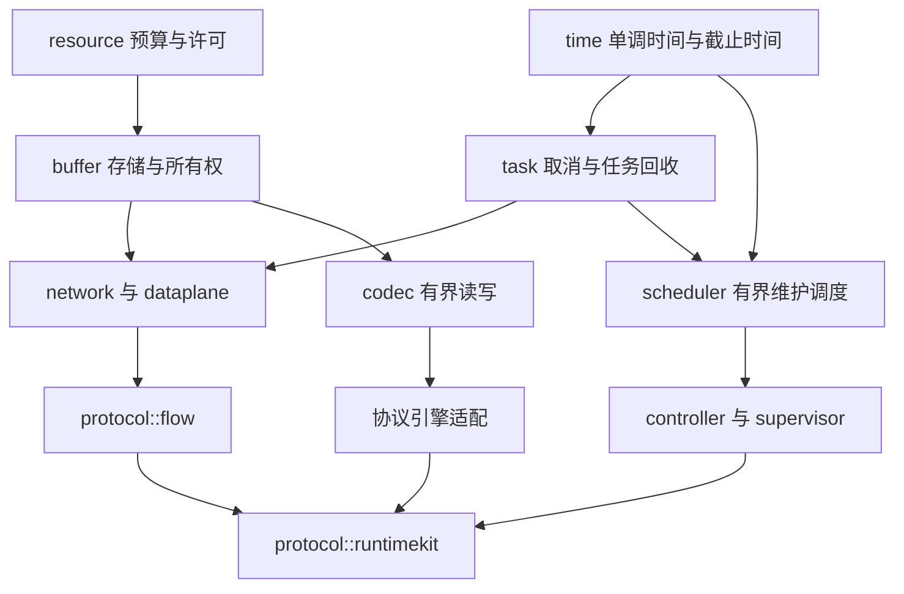

# Terraris 基础设施设计与实施顺序

状态：B1 已实现，后续阶段待实现。日期：2026-11-01。resource 的分级预算、RAII 许可和批量预留，以及 buffer 的布局、独占租约和固定存储已落地。下一步继续共享视图与受限缓存，再接任务、基础 I/O 和控制面运行时。

这些模块通过 Rust 类型和模块组织，不建立一个收集所有工具的 common 包。每个模块要有明确的所有权、资源上限、失败语义和独立验证方法。

## 1 依赖顺序

图表示实现依赖，`app` 最终装配这些组件。现有面板 HTTP 客户端继续保持独立，之后逐步接入共享的资源和任务管理。

## 2 基础模块

| 模块 | 第一版的内容 | 边界 |
| --- | --- | --- |
| `resource` | 受管理内存预算、作用域限额、RAII 许可、批量原子预留、关闭行为 | 不分配代理协议对象，不解释订阅 |
| `buffer` | 布局、独占可写缓冲、冻结/共享切片、所有者回收、受限池 | 不决定路由、用户或流量费率 |
| `task` | 取消传播、任务句柄登记、停止接收任务、限时等待与强制结束 | 不让业务任意创建无主后台任务 |
| `time` | 区分单调截止时间与 Unix 时间；可测试的超时策略 | 优先使用 Tokio 时间能力，不重写时钟运行时 |
| `network` | IP/域名目标、来源与目标元数据、TCP/UDP 类型、流与数据报端口 | 不把域名强制提前解析，不把 UDP 当字节流 |
| `dataplane` | 有界双向复制、部分写、半关闭、取消、数据报收发 | 不内置 PPanel DTO 或协议认证 |
| `codec` | 有上限的读取、长度检查、整数和地址编码辅助 | 不强行统一协议自身的特殊 wire 语义 |
| `telemetry` | 结构化错误、日志脱敏、基础计数、内存与队列观测 | 默认不使用订阅 ID/IP 作为指标标签 |
| `scheduler` | 任务独立退避、最大并发、同一任务不重叠、关停可等待 | 复用 task/time；不在每个协议内复制轮询器 |

只有出现实际消费者时才拆独立 crate。共享身份、Secret 等现有类型需要复用时再有针对性地抽出，并维持面板端口兼容，不为调整目录改变已完成的 API。

## 3 资源管理先于对象池

先实现 resource 的计量和许可，再让 buffer 持有这些许可。区分以下数量：

- 受管理 backing allocation 的容量，包括借出和池中闲置的分配。
- 一个连接或子流当前保留的缓冲容量。
- 队列中的消息数与逻辑字节数。
- 并发连接、在途握手、UDP 会话和等待资源的任务数。

字节上限不能代替对象数量上限。空数据报、很短的切片和等待任务仍占元数据与执行资源。

资源申请必须全有或全无。不能先持有进程许可，再无限等待连接许可；也不能先为 TCP 一个方向永久占住容量，再等待另一个方向。第一批实现提供非阻塞预留和双向 buffer 的批量预留，等待适配必须有取消、截止时间和等待者数量上限。

控制任务保留独立的并发和内存余量，数据面压力不能阻止用户撤销、设备续期或退出。现有 HTTP 响应大小限制只限制 body，不包含反序列化后的模型、TLS/HTTP 内部内存和其他在途响应；接入资源管理时仍需控制并发和快照重叠。

## 4 任务与时间

复用 [Tokio CancellationToken](https://docs.rs/tokio-util/latest/tokio_util/sync/struct.CancellationToken.html) 一类取消机制，区分进程、运行时和单次准备操作。丢弃一个候选不能取消已经发布的运行时；父作用域退出应取消其全部子任务。

TaskGroup 的关闭流程是停止创建任务、发出取消、等待完成，超过截止时间再终止余下任务并等待回收。取消信号不等于任务已经结束；必须保留任务句柄，才能确认 buffer、socket 和许可已经释放。

超时和租约使用单调时间，状态上报使用 Unix 毫秒。测试使用可控制的时间推进，避免用大量真实 sleep 验证超时。

错误按所属模块定义，例如资源耗尽、资源已关闭、布局溢出、帧过大、取消、超时和 I/O 失败。基础数据面不使用 `panel::Error` 表达 socket 错误，日志格式化不得携带 buffer 内容、密钥或原始面板响应。

## 5 I/O 基础

流端口以 Tokio AsyncRead / AsyncWrite 为基础，保留返回实际写入字节数的语义。共享复制循环使用 Terraris buffer，处理短写、WriteZero、半关闭、错误、取消和退出 deadline。限速与计量通过窄接口接入：入队不是成功转发，已写出的前缀也不能因后续失败被重复计数。

数据报端口保留来源、目标和包边界，明确过大或被截断的数据报处理。不能通过部分发送或拆成多个普通 UDP 包来悄悄改变协议。

先做直写路径。向量写、收发批处理、延迟合并和平台专有零拷贝在正确性基线及实测数据存在后再引入，且必须使用相同的 buffer 所有权和预算规则。

## 6 分批交付

| 顺序 | 交付内容 | 验收重点 |
| --- | --- | --- |
| B1 已实现 | resource 分级字节/名额预算、批量预留、BufferLayout、BufferScope 和 BufferLease；无空闲缓存 | 已覆盖上限、并发与关闭、Drop 归还、溢出和分配失败回滚 |
| B2 | 共享视图、Bytes 适配、受限缓存池和有界队列 | 最后引用前不回收；容量完整计量；取消/关闭不泄漏；池满可恢复 |
| B3 | task/time、network 元数据、TCP/UDP 基础 I/O、codec 和指标 | 双向复制、短写、半关闭、空/大包、截断、慢消费者、任务回收 |
| B4 | scheduler、users、runtimekit，再接 Controller/Supervisor | 使用已有预算、任务和 I/O 设施完成事务更新与代次切换 |
| B5 | SS2022 多用户适配原型及代理闭环 | 用户身份、撤销、限速、设备名额和计量接入统一路径 |

B1 与 B2 的所有权和冻结接口在设计时一起确定；按批实现时不开放随后会绕过预算的临时裸 Vec API。协议库的只读接口评估可以提前做，数据面集成以基建契约稳定为前提。

具体布局、类型、池化和预算算法见 [Buffer 系统设计](buffer.md)。

当前 B1 是同步 try 操作，不等待额度；一个批次属于同一作用域并检查全部祖先。resource 的关闭不主动撤销已授予许可。B2 的异步等待、缓存与共享拥有者尚未实现，B3 的双向复制和 TaskGroup 也未接线。

## 7 Polaris 参考

- [数据面性能约束](../../../Polaris/docs/performance.md)：池化不替代容量上限、取消归还许可、避免等待者惊群与递归处理。
- [共享流复制](../../../Polaris/internal/dataplane/stream.go)及[双向退出](../../../Polaris/internal/dataplane/duplex.go)：复制、策略、计数和半关闭的职责。
- [数据报复制](../../../Polaris/internal/dataplane/packet.go)：包边界与发送成功后的计数。
- [维护调度](../../../Polaris/internal/scheduler/group.go)：有界并发和同任务不重叠。

参考版本为 Polaris 56d52fb。Go 的 sync.Pool、goroutine 和显式 Release 通过 Rust 所有权及异步机制重新表达，不逐行搬运。
